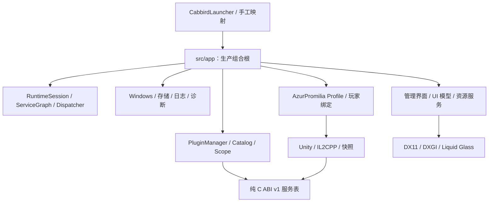

# 架构

Cabbird 是面向 Unity / IL2CPP 游戏的原生插件平台。Anomaly 3.x 提供平台生命周期、资源所有权、
渲染性能和界面设计的参考；Unity 引擎桥、AzurPromilia 游戏知识与 DX11 后端由 Cabbird 自己实现。

## 模块与依赖

| 位置 | 职责 |
| --- | --- |
| `src/app/core_main.cpp` | DLL 入口、生产服务装配、恢复策略、插件与平台工作线程接线 |
| `src/app/unity_runtime.cpp` | 配置到 Unity 运行时选项的转换，以及 Profile 证据到 UI 模型的转换 |
| `src/runtime/` | 游戏无关的 Session 状态、服务依赖图、调度器与停止传播 |
| `src/platform/windows/`、`src/services/` | 内存、模块、签名扫描、配置、可靠存储、结构化日志 |
| `src/game/unity/`、`src/mem/` | Unity Profile 解析、服务注册、IL2CPP 绑定、元数据与帧时钟 |
| `src/game/azur/` | AzurPromilia 的具体适配器、实体快照、Profile 运行时、控制玩家解析和游戏类型知识 |
| `src/plugin/` | 包扫描、依赖、capability、DLL generation、Scope 与热重载 |
| `src/render/dx11/` | Present / Resize / 输入、纹理缓存、DX11 玻璃材质 |
| `src/ui/` | 导航与管理界面、不可变显示模型、异步命令与设置 |
| `src/repository/` | 仓储网络、包校验、安装事务 |
| `include/cabbird/sdk/` | 插件与宿主之间的版本化纯 C ABI，以及可选 header-only C++ 助手 |

Runtime 内核不包含 Unity、AzurPromilia、UI 或插件实现头。游戏和平台服务在组合根中注册，
通过声明依赖接入 `ServiceGraph`。启动器的映射器位于 `src/launcher/manual_map.cpp`；
运行时不依赖 UE5 对象模型、DX12 或代理 DLL。

## 线程域

| 域 | 拥有者 | 工作与边界 |
| --- | --- | --- |
| Lifecycle | 宿主 | 服务与插件加载、状态转换、停止、卸载 |
| Worker | 宿主 | 网络、包扫描、解析、存储等可阻塞工作 |
| Game | Unity 帧锚点 | 插件 `on_update`、IL2CPP 调用、游戏快照；不阻塞、不创建线程 |
| Render | DXGI Present | 插件 `on_draw`、UI、绘制；不等待生命周期、读写文件或加载 DLL |

Game 和 Render 由引擎回调 pump，宿主不能用 Worker 模拟它们。跨域工作通过 Dispatcher。
Game 泵绑定到 Unity Adapter 的独立帧入口，生命周期延续到 Profile 停止，UI 退出不会切断它。
服务启动调用可以在排队阶段超时取消；一旦开始执行，生命周期必须持有它直到完成，再做回滚或停止。
普通有界 `Invoke` 保留超时返回的合同，回调不得借用已返回调用栈中的对象。

## Session 与卸载

`RuntimeSession` 拥有停止源、服务图、Dispatcher 和工作线程。启动失败时，只停止已经成功启动的
服务，并按依赖反序执行。插件先停止，所依赖的服务与 Dispatcher 随后才退出。
Runtime Worker 停止清理仍可回到 Lifecycle；等待 Worker 退出时持续泵该域，再按反序 join。
停止超时会记入诊断，不能据此提前释放仍在使用的状态；清理期间的非取消错误保留为停止首错。

`src/app/core_instance_claim.hpp` 用按 PID 命名的内核对象协调多个 Core 映像。不同映像的 C++
全局互斥锁互不相通，因此在启动服务之前先取得进程级所有权；该所有权跨 Session 保留。

每个插件 generation 拥有一个 `PluginScope`。窗口、Hook、任务、订阅、端点等宿主资源都登记在
Scope 的账本中。卸载顺序为：停止新资源和普通回调、取消排队任务、排空在飞回调、按注册反序撤销
资源、执行适当的生命周期清理，然后卸载 DLL。撤销失败或 drain 超时的 generation 保持隔离与映射，
禁止释放仍可能执行的代码。失败的激活同样走资源回滚。

注册的 `cabbird.game-lifecycle` 清理在普通回调冻结、Hook 禁用和租约排空后，于 Game 域
反序执行。它用于恢复剧情速度、UID 等游戏状态；之后才进入 Lifecycle `on_stop`。
Game 清理失败、超时或没有帧泵时，generation 保持隔离。描述符回调顺序与 ABI 不变。

Runtime 同时拥有仅监听本机的 WebSocket 广播与网页服务。插件查询独立 C 表；网页资源来自
本代不可变包，API 回调进入 Worker 并持有 generation lease，停止时通过 Scope 撤销应用。
结构化日志在自己的 Worker 按年龄和目录总量清理旧会话日志，保留正在写入的文件。

## Unity 与游戏知识

`UnityAdapter` 是宿主接口；当前具体实现 `src/game/azur/azur_unity_adapter.cpp` 提供实体、
变换、玩家、Dump 与 overlay 服务，并承载现有游戏布局。通用的 Profile、服务注册与帧时钟独立放在
`src/game/unity/`。AzurPromilia 的控制玩家类型、getter 和
字段解析集中在 `src/game/azur/azur_player_binding.cpp`，按 adapter generation 缓存反射结果。
游戏对象只在 Game 域读取，不把裸对象暴露为可跨帧使用的 SDK 所有权。

`profiles/unity-build-profiles.json` 保存按 build 记录的方法证据。优先通过 IL2CPP 元数据解析；
Profile RVA 路线必须通过入口字节验证。缺文件、格式错误、未匹配或验证失败时保留核心平台，
依赖服务以 `UNAVAILABLE` 降级。UI 兼容矩阵来自实际使用的 Profile 与绑定结果。

实体集合和玩家快照分别按配置采样。位置快路径沿用已有的入口字节与反射结果校验，失败后使用
既有降级路线。没有独立 Unity actor 工作负载的上游配置不作为有效性能开关保留。

插件自己的兼容数据通过 `cabbird.profile` 从当前 generation 包快照读取，统一 schema 校验，
加载后由插件持有 SDK `ProfileSnapshot`。只读 `cabbird.unity.metadata` 在 Game 域解析唯一的方法形状与
实例字段布局，供缺少入口字节的消费者使用，不改变已有的 IL2CPP 或 Unity v1 表。

## 渲染与 UI

DX11 使用共享 Present 重入范围，避免 Present 转发到 Present1 时重复绘制。同一帧对插件互斥锁
采用非阻塞准入；生命周期占用锁时跳过覆盖层，让游戏继续 Present。纹理按句柄缓存，设备失效时
统一释放和重建。Liquid Glass 的 DX11 后端负责按采样区域裁剪、低分辨率模糊与材质绘制，
复用 GPU 目标；延迟绘制保留注册时的透明度。字体上传后释放 CPU atlas 像素，设备恢复仍能重建。
默认字体和 ImGui 布局由既有 Worker 预读，Present 与设备恢复只消费内存；布局修改和渲染诊断
也交回该 Worker 落盘。嵌入提交恢复宿主各着色器阶段的资源绑定及被 ImGui 清空的着色器。

管理界面采用合并头部、响应式插件工具栏、底部悬浮导航、圆角内容卡片和统一主题。
独立窗口跟随客户端尺寸，游戏内保留浮动壳语义。插件操作异步提交到 Lifecycle。
`PlatformUiModel` 的修订号只随影响操作的目录、generation、依赖与启用状态变化；性能计数刷新
不使用户刚提交的操作失效。`apps/render_fixture/platform_preview.cpp` 在独立窗口运行同一套界面。
目录 Worker 由文件变更通知唤醒，Render 保留不可变目录快照，避免定时重读包和深拷贝。
启动器只烘焙自身需要的字体档位与图标；画面未变化时跳过提交，空闲时以消息唤醒降低刷新频率。

## ABI 与构建边界

公开 ABI 只使用定宽类型、C 结构、opaque handle 和函数表。读取字段前检查 `struct_size` 和
服务版本；分配与释放不跨 DLL 所有权边界。现有 v1 布局由 `abi/cabbird-sdk-v1-windows-x64.json`
冻结；公开边界改动时用本机 C / C++ 布局探针核对它，验证源码只放 `.temp/`。

Core 以手工映射方式运行。链接到 Core 的代码不能使用 loader-managed 静态 TLS；线程本地状态
使用 FLS 封装。新代码也不能通过函数级动态初始化静态对象间接引入 `_Init_thread_epoch`。

根 `CMakeLists.txt` 只编排构建模块。SDK 插件助手统一拥有包数据镜像和安装；内建插件在
`cmake/CabbirdBuiltinPlugins.cmake` 登记一次，预览 staging 与符号安装读取同一份 target 元数据。
构建与离线验证命令见 [构建](building.md)。
